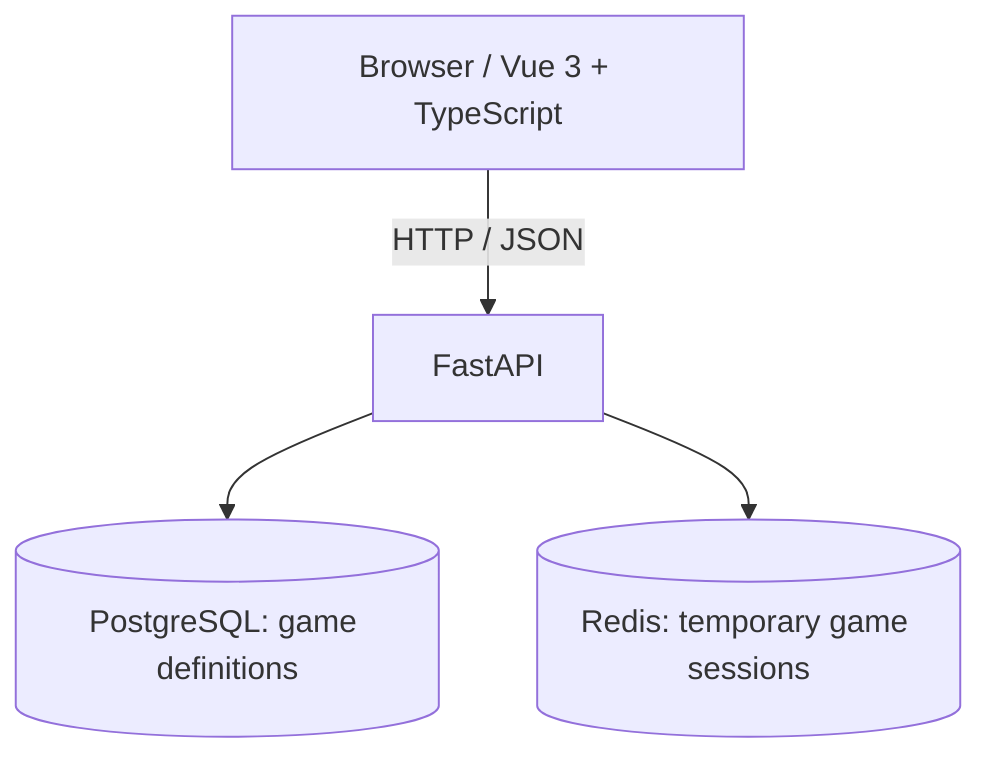

# Architecture — Developer Portfolio & Playground (v1)

**Status:** Draft — REST API design agreed at conceptual level; implementation details and final DTOs remain open.

**Related documents:** [`DOMAIN.md`](DOMAIN.md) (entities and invariants), [`GAME_DESIGN.md`](GAME_DESIGN.md) (gameplay and use cases).

## 1. System overview

The product has two areas:

- **Portfolio:** Public presentation of work, skills, and projects. Implemented in Vue 3 + TypeScript + Vite, with static content managed in the frontend. No backend persistence is needed for portfolio content in MVP.
- **Playground:** Card-based technical interview game. Vue handles the interface, animations and user input; FastAPI is authoritative for rules, answers, scoring, timer and session lifecycle.



Architecture is a **modular monolith**, not microservices. Domain objects and policies should remain independent of FastAPI, Redis and database ORM where practical.

Phase 2.1 implements a flat `app/domain/` package of frozen standard-library dataclasses and enums. Player state and session snapshots are immutable; lifecycle operations return validated replacements. Session time uses integer milliseconds and explicitly supplied timezone-aware timestamps. No persistence adapters or lifecycle operations are implemented in this phase. Pure Python game-rule implementation and unit tests precede PostgreSQL and Redis integration.

Phase 2.2 adds stateless `StreakPolicy` and `ScoreCalculator` in `app/domain/`.
The policy updates streak values and supplies exact `Fraction` multipliers. The
calculator accepts an already updated streak and returns an integer score delta,
rounding only base awards and filtering effects by SCORE type and answer outcome.
Neither service mutates snapshots or depends on FastAPI or persistence. GameSession
coordinates them in Phase 2.4.

Phase 2.3 adds stateless `EffectApplier` in `app/domain/`. It returns replacement
player state and remaining milliseconds after applying matching HP/TIME effects,
preserving score and streak. SCORE effects are handled exclusively by
ScoreCalculator. TIME seconds are converted to milliseconds; resulting time is
clamped at zero with no upper cap, while HP is uncapped. The service has no clock
or persistence dependencies and performs no session transitions. GameSession
rejects expired answers before applying effects.

Phase 2.4 implements GameSession lifecycle methods `activate`, `submit_answer`,
`assign_next_card` and `refresh`, with explicit aware `now` timestamps. The aggregate
validates transitions, IDs and question reuse, coordinates the three domain services,
and returns immutable replacements. Frozen AnswerResult snapshots retain accepted
answer feedback through refresh/finish and are cleared on next-card assignment.
No HTTP, persistence or random generation is implemented by these operations.

Phase 2.5 adds CardFactory with injected random.Random and in-memory catalog
sequences plus used-question IDs. It generates cards using integer weighted rarity
and effect draws and uniform template/question selection, returning None on question
exhaustion. Infeasible effect configuration raises ValueError before randomness;
duplicate catalog IDs are rejected. Fresh card UUIDs are independent of the seeded
RNG. It neither mutates inputs nor owns session usage tracking or game-over transitions.
Application handling of NO_QUESTIONS_AVAILABLE, catalog loading and seed scripts
remain future work; no database or API dependencies are added to the factory.

## 2. Responsibility boundaries

| Component | Owns |
| --- | --- |
| Vue frontend | Portfolio content, game display, visual countdown, animations, interactions |
| FastAPI | Validation, card generation, answer evaluation, game state changes, authoritative time calculation |
| PostgreSQL | Seeded Questions, AnswerOptions, CardTemplates, EffectDefinitions |
| Redis | Ephemeral GameSession snapshots, current card references/rolled effects, used question IDs, player state |

**Security:** The correct answer is not included in the card-fetch/start responses. It is returned only **after** the server has accepted and evaluated the answer. Do not rely on hiding data in the UI.

## 3. Playground gameplay summary

- New anonymous game: 100 HP, 0 score, 0 correct streak, **60 seconds** starting time, first card drawn automatically.
- No pausing. Time continues during result display and while waiting for a manual **Next Card** click.
- HP can exceed 100 and remaining time can exceed 60 seconds.
- Every question has exactly four answer options and one correct answer; difficulty is 1–5.
- A question cannot repeat within one GameSession but can reappear in later sessions.
- Positive instant effects trigger on correct answers; negative instant effects on incorrect answers. Effect types: HP, SCORE, TIME.
- Initial base points for difficulty 1–5 are **10 / 15 / 20 / 25 / 30**.
- Increment the correct streak before calculating the multiplier: **1–2 → 1×, 3–4 → 1.5×, 5+ → 2× maximum**. The streak itself is uncapped. Incorrect answers reset it to zero and earn no base points.
- The multiplier applies **only to base points**, never SCORE effects. Round the multiplied base award **half-up to the nearest integer** before adding matching SCORE effects: 22.5 → 23, 37.5 → 38. Do not use Python's built-in `round()`.
- Total score is an integer and may be negative, with **no lower bound** or clamping to zero.
- Session ends if HP <= 0, time <= 0, or no compatible unused questions remain. When both HP and time reach zero due to the **same resolved answer**, use `HP_DEPLETED`; if time had already expired before answer acceptance, use `TIME_EXPIRED` without applying the answer or its effects.
- **Play Again** starts a new independent session, without carrying over stats or used questions.
- No accounts, leaderboard or permanent session/answer-history storage in MVP. Finished results are available only temporarily until Redis expiry.

Detailed game rules are maintained in `GAME_DESIGN.md` and `DOMAIN.md`, not duplicated here.

## 4. PostgreSQL — durable game definitions

Initially seed (idempotently) the following entities; no admin panel for MVP:

- `questions`: id (UUID), text, category, difficulty (1–5), `correct_answer_id`.
- `answer_options`: id (UUID), question_id (FK), text. Exactly four options per question; the referenced correct answer must belong to the same question. Enforce this with a suitable constraint/validation strategy during schema design.
- `card_templates`: id (UUID), rarity (COMMON/RARE/EPIC), min/max difficulty, positive/negative effect budgets.
- `effect_definitions`: id (UUID), effect type (HP/SCORE/TIME), trigger (CORRECT/INCORRECT), signed value, cost, weight, effect rarity.

Questions are matched to templates dynamically by difficulty; there is no question-template join table. Effects come from a common catalog and are selected dynamically according to budget and rarity; no template-effect join table for MVP.

### Random card/effect selection

- Card rarity draw probabilities: **COMMON 70%, RARE 20%, EPIC 10%**. Re-normalize among rarities that still have an eligible template and unused compatible question.
- Within the selected rarity, eligible templates have **equal probability**.
- Allowed effect rarities: Common card → Common only; Rare card → Rare only; Epic card → Rare or Epic.
- Positive and negative budgets are independent; they are maxima, not amounts that must be fully spent.
- A positive budget greater than zero requires at least one corresponding positive effect; likewise for negative budgets (seed configurations must ensure eligible effects exist).
- Pick a random target count of 1–3 effects per nonzero-budget outcome; select effect definitions with **weighted random** choices, respecting remaining budget and at most one HP, SCORE and TIME effect per outcome. A target count may be reduced if eligible candidates run out.
- The previously agreed effect catalog/costs are preliminary balancing values, not final production constants.

## 5. Redis — ephemeral session store

One Redis key per GameSession, containing one serialized JSON object:

```text
game:session:{session_id}
```

Conceptual minimum contents:

```json
{
  "status": "active",
  "phase": "awaiting_answer",
  "player": {"hp": 100, "score": 0, "correct_streak": 0},
  "remaining_time_ms": 60000,
  "last_updated_at": "2026-10-11T00:00:00Z",
  "current_card": {
    "id": "card-uuid",
    "question_id": "question-uuid",
    "template_id": "template-uuid",
    "effects": []
  },
  "used_question_ids": ["question-uuid"],
  "game_over_reason": null
}
```

Persist only **dynamic session data** and the references to game definitions; retrieve static question/option/template data from PostgreSQL when needed. Keep the rolled effects in Redis so they cannot be regenerated on subsequent requests.

- Initial proposed Redis TTL: **15 minutes since the last successful allowed state-changing action**.
- TTL is cleanup, **not** the game timer; ordinary reads must not extend it.
- When the key expires, the session/result is unavailable; there is no permanent game history.
- Domain session models are serialized/deserialized at the repository boundary.

## 6. Authoritative timer

Store `remaining_time_ms` and `last_updated_at`. On operations, subtract elapsed real time, clamped at zero, before evaluating an answer. Update the timestamp as part of an accepted state transition. The frontend can animate a countdown but never determines authoritative expiry.

Processing order for `SubmitAnswer`:

1. Load and validate session under concurrency control.
2. Calculate elapsed time. If time already expired, finish `TIME_EXPIRED` and **do not** evaluate or apply answer effects.
3. Validate active status, `AWAITING_ANSWER` phase and submitted option.
4. Evaluate answer using the PostgreSQL definition; update correct streak and base score.
5. Apply the matching pre-rolled instant effects.
6. Resolve Game Over: `HP_DEPLETED` precedes `TIME_EXPIRED` when both arise from the same answer. Otherwise transition to `AWAITING_NEXT_CARD`.
7. Save the resulting session atomically; return evaluation and updated state. Reveal `correct_answer_id` only in this post-evaluation response. **No answer explanations** for MVP.

The domain accepts explicit aware timestamps. UTC subtraction and integer division
produce whole elapsed milliseconds; last_updated_at advances by those milliseconds
rather than directly to now, preserving the submillisecond remainder. Backward or
naive timestamps are rejected. Basic input types are checked first, then active-session
expiry precedes semantic gameplay checks. Refresh advances active time and detects
termination; created/finished sessions remain unchanged. TIME_EXPIRED wins over
pre-existing HP depletion; HP_DEPLETED wins only for simultaneous post-answer depletion.
Caller clock acquisition, retry semantics and transport errors remain application work.

## 7. Concurrency and correctness

Use Redis optimistic transactions with **WATCH / MULTI / EXEC** for session changes, including `SubmitAnswer` and `NextCard`.

- Read/modify/write one session snapshot atomically.
- If competing writes occur, retry by reloading and **revalidating state**; a duplicate answer must not award points twice.
- A new card cannot be drawn while an answer is pending; a submitted card cannot be answered twice.
- Avoid generating a new random card/effect outcome before a retry in a way that would leak or wrongly persist state; the implementation should clearly define where candidate generation occurs in the transaction workflow.

## 8. Application layer and REST API

Suggested layering:

```text
API routes / request-response DTOs
           ↓
Application use cases (StartGame, SubmitAnswer, NextCard, GetGameState, FinishGame)
           ↓
Domain entities / services / policies
           ↓
Repository interfaces
           ↓
PostgreSQL & Redis adapters
```

`StartGame` and **Play Again** use the same `POST /api/v1/games` operation, creating a new UUID-backed session and drawing the first card automatically. `FinishGame` is an internal transition and does not need a public endpoint.

### Endpoint summary (MVP)

| Method | Path | Use case | Notes |
| --- | --- | --- | --- |
| `POST` | `/api/v1/games` | StartGame / PlayAgain | No body; new anonymous session and first card; `201 Created` |
| `GET` | `/api/v1/games/{id}` | GetGameState | Restore/synchronize view; can detect expiry; no TTL extension on ordinary reads |
| `POST` | `/api/v1/games/{id}/answers` | SubmitAnswer | Body: `card_id`, `answer_id`; accept once per drawn card |
| `POST` | `/api/v1/games/{id}/cards/next` | NextCard | Only in `AWAITING_NEXT_CARD`; draws one new eligible card |

Use consistent response field names for game state and player state across endpoints. These samples illustrate agreed behavior; exact Pydantic DTO definitions will be finalized during implementation.

### StartGame response

```json
{
  "game_id": "<uuid>",
  "session_token": "<secret-token>",
  "status": "active",
  "phase": "awaiting_answer",
  "player": {"hp": 100, "score": 0, "correct_streak": 0},
  "remaining_time_ms": 60000,
  "card": {
    "id": "<card-uuid>",
    "rarity": "common",
    "question": {
      "id": "<question-uuid>",
      "text": "What does HTTP 429 mean?",
      "category": "networking",
      "difficulty": 2,
      "options": [
        {"id": "a1", "text": "Unauthorized"},
        {"id": "a2", "text": "Too Many Requests"},
        {"id": "a3", "text": "Forbidden"},
        {"id": "a4", "text": "Internal Server Error"}
      ]
    },
    "effects": [{"type": "hp", "value": 10, "trigger": "correct"}]
  }
}
```

The `session_token` appears **only in the StartGame response**; do not return it from GetGameState. The question's `correct_answer_id` is **never** included with an unanswered card. Showing the pre-rolled effects is intentional game feedback, but values remain server-authoritative.

### SubmitAnswer

Request (`POST /api/v1/games/{id}/answers`):

```json
{"card_id": "<card-uuid>", "answer_id": "a2"}
```

Successful `200 OK` response after server-side acceptance/evaluation:

```json
{
  "is_correct": true,
  "correct_answer_id": "a2",
  "base_score": 15,
  "streak_multiplier": 1,
  "effects_applied": [{"type": "hp", "value": 10}],
  "player": {"hp": 110, "score": 15, "correct_streak": 1},
  "remaining_time_ms": 48000,
  "status": "active",
  "phase": "awaiting_next_card",
  "game_over": false
}
```

Return `correct_answer_id` **only after accepted evaluation** (never for an expired session, invalid phase or other rejected attempt). Do not send answer explanations in MVP. For a terminal result, include the finished status and game-over reason in a consistent DTO.

### NextCard and GetGameState

- `NextCard`: no request body; require `ACTIVE / AWAITING_NEXT_CARD`; check authoritative timer and HP; choose eligible template, question and effects. Return the new card and synchronized state. If none are available, finish `NO_QUESTIONS_AVAILABLE`.
- `GetGameState`: return current state and the appropriate safe view: unanswered card (without correct answer), already-resolved answer result (when available), or game-over summary. Never expose a correct answer during `AWAITING_ANSWER`.
- `GetGameState` may update a session to `FINISHED / TIME_EXPIRED` as part of observing an expired timer, using the same concurrency safeguards. Read operations must not renew the Redis TTL.

### Anonymous session authorization

- At game creation, generate a high-entropy cryptographically random bearer-style `session_token`, separate from public `game_id`.
- Keep the token temporarily on the frontend in `sessionStorage`, scoped to the browser tab (session restore behavior still subject to browser lifecycle).
- Every subsequent game request sends `X-Game-Token: <session_token>` over HTTPS.
- Store a **hash** of the token in Redis session data; never store the plaintext token. Verify tokens server-side using a safe constant-time comparison (e.g. `hmac.compare_digest` on equivalent-length digests).
- An unknown game ID, expired session, or invalid token must not reveal protected session state. Exact distinction between `401`/`403`/`404` can be finalized with consistent non-leaking behavior.
- The token is a session authorization credential, **not** a user account or login token; do not log it or include it in URLs.
- Since the initial game response includes the token, disable accidental shared caching of sensitive responses (`Cache-Control: no-store`). Rate limits and abuse protections remain implementation work.

### Frontend timer synchronization

Use **local countdown + backend validation**, not periodic polling:

1. Start the visual countdown from `remaining_time_ms` on the response, using a monotonic client clock such as `performance.now()`.
2. Re-synchronize after `SubmitAnswer` and `NextCard`, and after `GetGameState` when recovering from a page refresh.
3. When the display reaches zero, call `GET /api/v1/games/{id}` for authoritative confirmation; the server may either finish the game or return corrected remaining time.
4. The clock does **not** pause for card animations, result display, API requests or waiting to click Next Card.

Network transit time may make a naive local countdown slightly optimistic; account for this conservatively during implementation. The backend is always authoritative.

### HTTP errors (provisional mapping)

```json
{"error": {"code": "INVALID_GAME_PHASE", "message": "Cannot submit an answer in the current game phase."}}
```

| Status | Use |
| --- | --- |
| `400 Bad Request` | Validly structured but semantically invalid answer selection |
| `401/403` | Missing/invalid anonymous session credential (finalize externally indistinguishable behavior) |
| `404 Not Found` | Missing or expired session (avoid session existence leaks) |
| `409 Conflict` | Invalid phase, stale card, duplicate answer, already-finished game |
| `422 Unprocessable Entity` | Request schema validation failure (FastAPI) |
| `500 Internal Server Error` | Unexpected failure; avoid disclosing internal details |

Concurrency conflicts should not blindly retry writes: reload under `WATCH`, reevaluate timer and phase, then either commit one valid mutation or return a suitable conflict. Rate limiting, maximum retry count and idempotency behavior are still to be specified.

## 9. Open decisions / implementation tasks

- Full-loop domain validation lives in `backend/tests/domain/test_game_loop.py`, using real CardFactory/GameSession components, seeded randomness and explicit timestamps. Application orchestration is not implemented by these tests.
- Future NextCard orchestration must refresh authoritative time and honor terminal state **before** converting factory exhaustion (`None`) into `NO_QUESTIONS_AVAILABLE`. If time and the question pool are both exhausted, preserve `TIME_EXPIRED`. CardFactory only reports exhaustion; GameSession still lacks a public exhaustion transition. Design a narrowly constrained aggregate transition with the future use case rather than exposing an arbitrary finish operation or mutating snapshots externally. StartGame's empty-pool response remains an open decision in `GAME_DESIGN.md`.
- Final Pydantic DTO field definitions, precise 401/403/404 behavior, abuse protection and request retry/idempotency strategy.
- Concrete PostgreSQL DDL, composite correctness constraint, seed scripts and migrations.
- Redis serializer/versioning, clock handling, expiration behavior and optimistic-lock retry policy.
- Final effect weights/costs and balancing simulations.
- Whether to track extra per-session statistics for the end screen, and how long finished result screens remain retrievable.

**Do not introduce permanent game sessions or answer-attempt persistence without a new explicit decision.**
