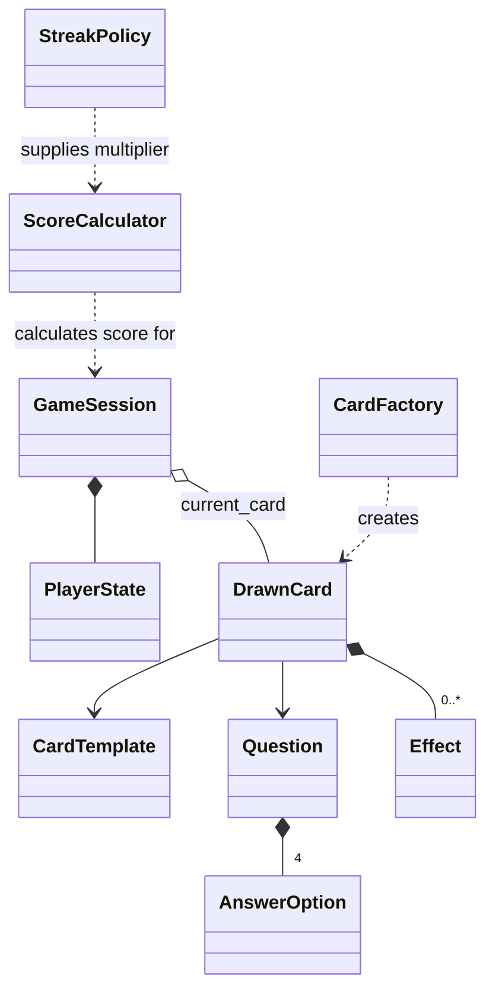
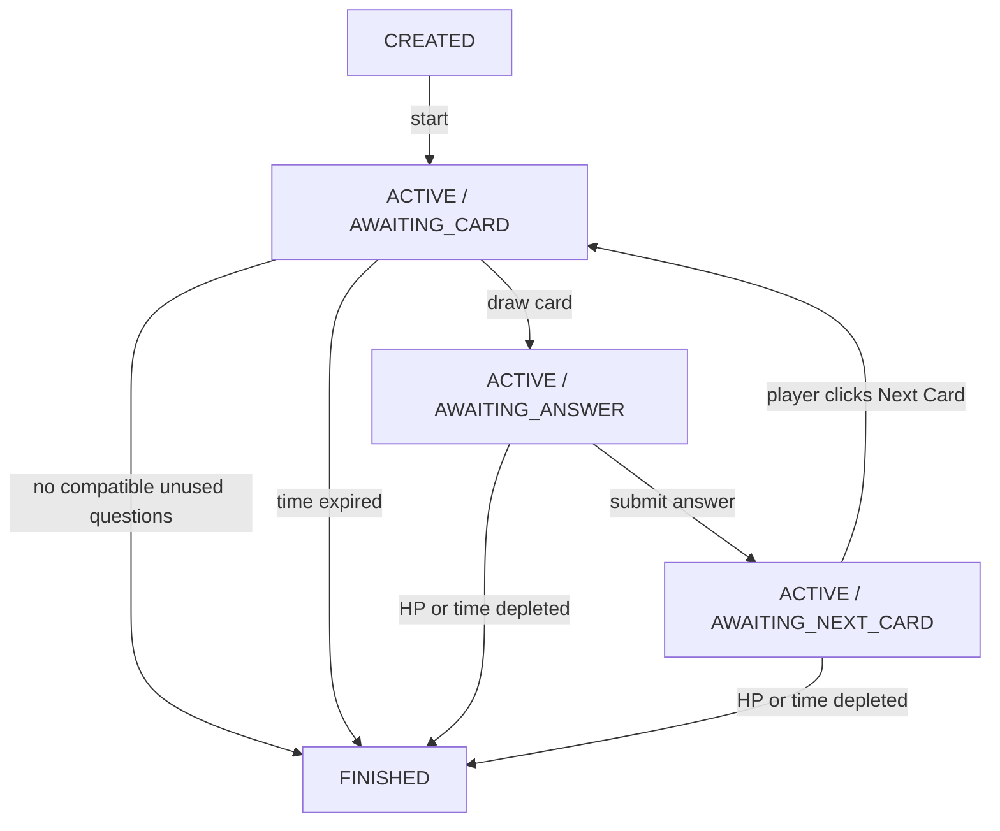

# Playground — Domain Model (v1)

**Status:** Draft — consolidated agreed decisions, with unresolved balancing/implementation items explicitly marked

**Scope:** Card-based technical interview game in the developer portfolio

**Backend:** Python / FastAPI (domain layer independent of framework and persistence)

This document distinguishes **agreed rules** from **proposals / unresolved decisions**. Code examples are conceptual Python models, not production-ready implementations.

## 1. Domain overview

The player answers technical interview questions presented as cards. Each drawn card combines a reusable card template, one compatible question, and randomly assigned instant effects. A game session tracks the player, current card, remaining time, and progression until a game-over condition is met. Game sessions are anonymous and ephemeral: live state is held in Redis and no permanent game history is stored.



### Main concepts

| Concept | Responsibility |

| --- | --- |

| `GameSession` | Aggregate root; game lifecycle, state transitions, invariant enforcement |

| `PlayerState` | Current HP, score, correct-answer streak |

| `Question` | Question text, category, difficulty, possible answers, correct answer |

| `AnswerOption` | One selectable answer |

| `CardTemplate` | Reusable card mold: rarity, compatible difficulty range, effect budgets |

| `DrawnCard` | One generated card within a session: template + question + rolled effects |

| `Effect` | Instant modification of HP, score, or remaining time |

| `CardFactory` | Selects compatible question/template and assigns effects |

| `ScoreCalculator` | Calculates base score plus card-related score changes |

| `StreakPolicy` | Calculates score multiplier from correct-answer streak |

## 2. Agreed game rules

### Session and game over

- Initial HP: **100**.

- Initial time: **60 seconds**.

- The timer runs continuously; **no pausing**.

- Remaining time **may exceed 60 seconds** after positive time effects.

- HP **may exceed 100** after positive HP effects.

- The game finishes when **HP <= 0**, **remaining time <= 0**, or **no unused compatible questions are available**.

- Game-over reasons: `HP_DEPLETED`, `TIME_EXPIRED`, `NO_QUESTIONS_AVAILABLE`.

- After answering, the result is shown; the player must manually click **Next Card**. Time keeps ticking while awaiting that click.

- The backend, not the frontend countdown, must be authoritative about elapsed time.
- The first card is drawn automatically when starting a new game. Subsequent cards require a **Next Card** click.
- **Play Again** creates an entirely new, independent session (new ID, full HP, 60 seconds, score/streak reset, empty used-question set), using the same StartGame operation.
- A finished session can be displayed briefly, but game/session history is **not persisted permanently**.

### Questions and cards

- `Question` is separate from `CardTemplate`: the template is the mold; the question is its content.

- Question difficulty is an integer from **1 to 5**.

- MVP answer format: **multiple choice with exactly four options and one correct answer**; free text and voice are deferred. `Question.correct_answer_id` refers to one of that question's options.

- A `CardTemplate` specifies its allowed `min_difficulty` and `max_difficulty`, preventing arbitrary question/template combinations.

- `rarity` is an explicit attribute: `COMMON`, `RARE`, `EPIC`.

- **Rarity governs both card draw probability and eligible effect rarity**, while template budgets limit total effect cost. Common cards use Common effects; Rare cards use Rare effects; Epic cards use Rare or Epic effects.

- A question **cannot appear twice in the same session**, but may appear in later sessions.

- If no unused compatible question exists for a chosen template, try another template. If no valid template/question combination remains, end the session with `NO_QUESTIONS_AVAILABLE`.

### Effects

- MVP effects are **instant only**, with types `HP`, `SCORE`, and `TIME`.

- An effect triggers either on `CORRECT` or `INCORRECT`.

- **Positive effects** apply on correct answers; **negative effects** apply on incorrect answers.

- A drawn card may have only positive effects, only negative effects, or both, including multiple effects where allowed by the budget. A zero budget indicates no effects for that outcome.

- Effects are rolled for a drawn card, within the `CardTemplate`'s positive and negative effect budgets.

- No persistent/duration-based card effects in MVP.

### Effect generation and rarity (agreed)

- Card rarity distribution: **Common 70%, Rare 20%, Epic 10%**. Only eligible rarities participate; redistribute probability proportionally across rarities with at least one eligible template/question pair.
- Templates within an eligible rarity are selected **uniformly** (no template weight).
- Allowed effect rarity: **Common → Common**, **Rare → Rare**, **Epic → Rare or Epic**.
- Positive and negative budgets are independent. A zero budget yields no effect for that outcome; a positive budget must yield at least one eligible effect (seed data/configuration must guarantee feasibility).
- Budgets are **upper bounds**, not amounts that must be spent.
- At most one effect of each type (`HP`, `SCORE`, `TIME`) **per answer outcome**.
- For each outcome with positive budget, choose a target count uniformly at random from 1 to min(3, number of eligible distinct effect types). Select eligible effects using their positive `weight`, filtering after each selection by remaining budget and unused type. Actual count can be smaller than target.
- `EffectDefinition` is a seeded catalog entry with `id`, `type`, signed `value`, `trigger`, `rarity`, positive `cost`, positive `weight`. `Effect` on a drawn card is the rolled effect snapshot.

**Provisional effect catalog (balancing v1; values may change after playtesting):**

| Rarity | HP deltas | SCORE deltas | TIME deltas | Costs for lower/higher strength |
| --- | --- | --- | --- | --- |
| Common | ±10 / ±20 | ±15 / ±30 | ±3s / ±5s | 1 / 2 |
| Rare | ±25 / ±35 | ±40 / ±60 | ±7s / ±10s | 3 / 4 |
| Epic | ±45 / ±60 | ±80 / ±120 | ±12s / ±15s | 5 / 6 |

Each signed variant is a separate definition with `CORRECT` for positive and `INCORRECT` for negative. Suggested relative weights for lower/higher strength: **70 / 30**. Example template budget ranges for positive and negative sides respectively: Common 1–4, Rare 3–7, Epic 5–10. These are seed-design guidelines, not enforced rarity caps.

- The correct-answer streak is a separate scoring rule and is **not** a Card Effect.

### Correct-answer streak and scoring

- There is **only a correct-answer streak**; no incorrect-answer streak.

- Correct answer: increment `correct_streak` by 1.

- Incorrect answer: reset `correct_streak` to 0.

- The streak influences **only the multiplier of base points for a correct answer**; it does **not** multiply Card Effect bonus points or influence HP/time.

- Base points depend on question difficulty. The current **proposed starting values** are:

| Difficulty | Base points (provisional) |

| --- | ---: |

| 1 | 10 |

| 2 | 15 |

| 3 | 20 |

| 4 | 25 |

| 5 | 30 |

For a correct answer:

```text
score_gain = base_points(question.difficulty) * streak_multiplier(correct_streak)
             + sum(score effects triggered by CORRECT)
```

The streak is incremented **before** calculating the multiplier (as in our previous example). Incorrect answers receive no base points; relevant negative card effects still apply.

## 3. Conceptual Python domain model

The declarations below indicate desired attributes and relationships; enum imports, field validation, implementations and persistence mappings will follow later.

### Question and AnswerOption

```python
@dataclass(frozen=True)
class AnswerOption:
    id: UUID
    text: str
@dataclass(frozen=True)
class Question:
    id: UUID
    text: str
    category: QuestionCategory  # Networking, Databases, System Design, Security, DDD, Performance
    difficulty: int             # 1..5
    options: tuple[AnswerOption, ...]
    correct_answer_id: UUID
```

A question knows nothing about card templates, rarity or card effects.

### CardTemplate

```python
class CardRarity(str, Enum):
    COMMON = "common"
    RARE = "rare"
    EPIC = "epic"
@dataclass(frozen=True)
class CardTemplate:
    id: UUID
    rarity: CardRarity
    min_difficulty: int
    max_difficulty: int
    positive_effect_budget: int
    negative_effect_budget: int
```

### Effect and DrawnCard

```python
class EffectRarity(str, Enum):
    COMMON = "common"
    RARE = "rare"
    EPIC = "epic"


class EffectType(str, Enum):
    HP = "hp"
    SCORE = "score"
    TIME = "time"
class EffectTrigger(str, Enum):
    CORRECT = "correct"
    INCORRECT = "incorrect"
@dataclass(frozen=True)
class Effect:
    type: EffectType
    value: int        # signed delta; e.g. +10 HP, -5 seconds
    trigger: EffectTrigger
@dataclass(frozen=True)
class EffectDefinition:
    id: UUID
    type: EffectType
    value: int
    trigger: EffectTrigger
    rarity: EffectRarity
    cost: int
    weight: int


@dataclass(frozen=True)
class DrawnCard:
    id: UUID
    template: CardTemplate
    question: Question
    effects: tuple[Effect, ...]
```

`Effect` is an outcome-dependent delta, not a streak bonus. A correct-answer effect should be beneficial, and an incorrect-answer effect detrimental; the exact sign/value validation will be implemented when we finalize effect policy.

### PlayerState

```python
@dataclass
class PlayerState:
    hp: int = 100
    score: int = 0
    correct_streak: int = 0
```

### GameSession

```python
class GameStatus(str, Enum):
    CREATED = "created"
    ACTIVE = "active"
    FINISHED = "finished"
class GamePhase(str, Enum):
    AWAITING_CARD = "awaiting_card"
    AWAITING_ANSWER = "awaiting_answer"
    AWAITING_NEXT_CARD = "awaiting_next_card"
class GameOverReason(str, Enum):
    HP_DEPLETED = "hp_depleted"
    TIME_EXPIRED = "time_expired"
    NO_QUESTIONS_AVAILABLE = "no_questions_available"
@dataclass
class GameSession:
    id: UUID
    status: GameStatus
    phase: GamePhase
    player: PlayerState
    remaining_time: float
    last_updated_at: datetime
    current_card: DrawnCard | None
    used_question_ids: set[UUID]
    game_over_reason: GameOverReason | None
```

`GameSession` is the **aggregate root**. Game state must be changed through domain operations rather than unrestricted external mutation.

## 4. Game lifecycle and transitions



Conceptual aggregate operations:

```python
session.start()
session.assign_card(card)
session.submit_answer(answer_id)
session.apply_effect(effect)
session.finish(reason)
```

`CardFactory` handles selection/generation, while `ScoreCalculator` and `StreakPolicy` handle their respective calculations. The exact method signatures and orchestration boundaries remain to be worked out.

### Draw sequence

1. Filter to templates with unused compatible questions; choose rarity using **70/20/10**, renormalized over eligible rarities.

2. Pick a template **uniformly** from eligible templates of that rarity.

3. Find an unused question whose difficulty fits the template.

4. Roll effects using **rarity compatibility, independent budgets, distinct effect types, random target count and weighted definitions**.

5. Create a `DrawnCard` and mark its question as used for this session.

6. If selection is impossible, try another suitable template; finish only if no viable combination remains.

## 5. Agreed use-case behavior (MVP)

### StartGame / Play Again

- **StartGame** creates a new anonymous `GameSession` with a new UUID, HP 100, score 0, correct streak 0, 60 seconds remaining, and no used questions.
- It **automatically draws the first card**, then activates the session in `AWAITING_ANSWER`; the authoritative timer begins when the backend activates the session.
- **Play Again is another StartGame**, not a separate domain reset or `/restart` endpoint; questions used in earlier sessions are again eligible.
- The API response includes session ID, player state, remaining time, and safe card data. Never expose the correct answer before accepting an answer.

### SubmitAnswer

- Requires `ACTIVE / AWAITING_ANSWER`, a currently assigned card, a valid answer option, and remaining time greater than zero.
- Backend validates the answer against the stored question, updates streak, calculates base score with the streak multiplier, applies appropriate instant card effects, and checks for game over.
- Response includes correctness, **correct answer ID only after evaluation**, applied effects, player state, remaining time, and game-over status.
- **No answer explanation is included** in the MVP; no `Question.explanation` field is required.
- If the game continues, transition to `AWAITING_NEXT_CARD`. The clock continues to run while the result is visible.

### NextCard

- Requires an active session in `AWAITING_NEXT_CARD`, not a pending unanswered question.
- Check time/HP; select only templates for which an unused compatible question exists, select a valid question, roll effects and return the next drawn card. Move to `AWAITING_ANSWER`.
- If no eligible question/template combination remains, finish with `NO_QUESTIONS_AVAILABLE`.

### FinishGame

- Transitions to `FINISHED`, records a game-over reason and prevents further gameplay actions.
- Final result may be returned/displayed while the Redis record exists. **Do not persist game outcomes, leaderboard entries, or historical sessions to PostgreSQL** in MVP.

### Server-authoritative boundary

- **Backend (FastAPI):** card/question selection, randomness, answer evaluation, HP, score, streak, time, game-over logic, state transitions.
- **Frontend (Vue):** rendering, animations, interaction, showing the timer estimate and responses; the UI is never authoritative about game state.
- Question's `correct_answer_id` must never be included in the unanswered card payload, even if hidden visually in the UI.

### Transient storage decisions

| Data | MVP home | Notes |
| --- | --- | --- |
| Questions, answer options, card templates, effect definitions | PostgreSQL | Permanent content/configuration |
| Active `GameSession`, current `DrawnCard`, used question IDs, time reference | Redis | Temporary authoritative session state |
| Finished result | Redis temporarily / final API response | No permanent history |
| User accounts / leaderboard | Not in MVP | Explicitly excluded |

**Agreed:** One serialized JSON session under `game:session:{session_id}`; minimal state references static PostgreSQL records by ID and stores rolled effects. Redis inactivity TTL is **15 minutes**, refreshed only on accepted state-changing actions (not reads). Backend computes elapsed time; `WATCH/MULTI/EXEC` prevents concurrent double updates. TTL is housekeeping, **not** the game timer.

---

## 6. Domain invariants

1. Question difficulty must be within **1..5**.

2. A drawn question must be compatible with its template's allowed difficulty range.

3. A question may be drawn at most once per `GameSession`.

4. Rolled effects must honor positive/negative budgets and their associated answer outcome.

5. Each drawn card can be answered at most once.

6. Answers are accepted only during `ACTIVE / AWAITING_ANSWER`.

7. A new card cannot be drawn while the previous one still awaits an answer.

8. No actions that continue gameplay are accepted after `FINISHED`.

9. A session ends if HP or remaining time is depleted, or if no valid questions remain.

10. No pausing; time advances independently of the frontend.

11. Streak multipliers apply only to base score for correct answers.

## 7. Suggested code organization (not final)

```text
backend/
└── app/
    ├── domain/
    │   ├── models/
    │   │   ├── question.py
    │   │   ├── card.py
    │   │   ├── effect.py
    │   │   ├── player.py
    │   │   └── game_session.py
    │   ├── services/
    │   │   ├── card_factory.py
    │   │   └── score_calculator.py
    │   └── policies/
    │       └── streak_policy.py
    ├── application/
    ├── infrastructure/
    └── api/
```

This is a modular monolith, not a microservice design. Domain classes should be independent of FastAPI, database ORM, and transport DTOs.

## 8. Recently finalized backend rules

- Anonymous sessions only; **no permanent results, accounts, history or leaderboard** in MVP. PostgreSQL stores seeded `questions`, exactly four `answer_options` per question, `card_templates`, and `effect_definitions`. Correct answer is identified by `questions.correct_answer_id`, which must belong to the same question; it is never sent in an unanswered-card API payload.
- Start Game creates a new session and **draws the first card immediately**; Play Again calls Start Game again with a new ID and empty used-question set.
- After an accepted answer, return correctness, the correct answer ID, applied effects and updated state; **do not return explanations**.
- The timer starts at activation, never pauses, and is calculated from the authoritative backend clock. It must be checked **before** processing an answer or granting time effects. If expired first, finish with `TIME_EXPIRED` without evaluating the answer.
- After applying valid-answer effects, if both HP and time are depleted in the same operation, **`HP_DEPLETED` takes precedence**.
- GameSession lives as minimal JSON in Redis (`remaining_time_ms`, `last_updated_at`, current question/template IDs, rolled effects, player state, used question IDs, phase/status). Current question content and answer validation come from PostgreSQL.

## 9. Open decisions / implementation details

- **Streak multiplier thresholds and values** are not decided.
- **Base point numbers** (10 / 15 / 20 / 25 / 30) remain provisional.
- **Balancing catalog and budget ranges** above are provisional; validate with playtesting.
- **Lower score bound** (can score become negative?) is not decided.
- **Effect rounding and numeric types** for fractional multipliers remain open.
- **Exact API request/response schemas, Redis retry policy, refresh UX and final result details** remain open.
- **PostgreSQL constraints / migration approach** and final schema are still to be designed.

## 10. Next step

Consult [`GAME_DESIGN.md`](GAME_DESIGN.md) for use cases and [`ARCHITECTURE.md`](ARCHITECTURE.md) for agreed storage choices. Next: complete REST API contracts, persistence schema and error handling before the first vertical slice.
