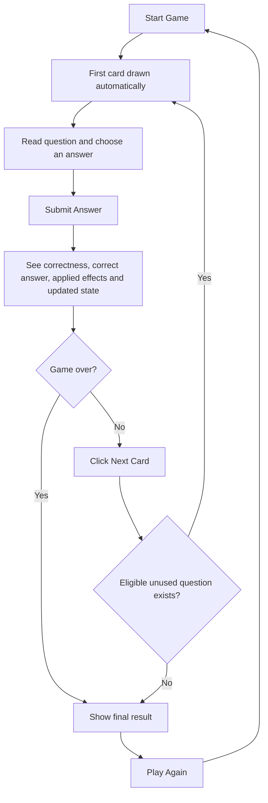

# Playground — Game Design & Use Cases (v1)

**Status:** Draft — agreed behavior documented; unresolved details explicitly marked  
**Scope:** Anonymous, time-limited, card-based technical interview game  
**Companion:** [`DOMAIN.md`](DOMAIN.md) is the source of truth for entities, invariants, and scoring concepts.

This document describes **how a game plays and how its use cases behave**. It intentionally does not specify final HTTP payloads, PostgreSQL schema, or Redis serialization; those belong in a future `ARCHITECTURE.md`.

## 1. Game at a glance

A player starts an anonymous session and immediately receives a card containing a technical multiple-choice question. The player submits one answer; the backend evaluates it, updates points and the correct-answer streak, and applies any outcome-matching instant effects. The player sees the result and chooses when to click **Next Card**. The timer never pauses. The session ends when HP or time reaches zero, or when no eligible unused question remains.

| Setting | Agreed behavior |
| --- | --- |
| Starting HP | 100 |
| Starting time | **60 seconds** |
| Starting score / streak | 0 / 0 |
| First card | Automatically drawn on Start Game |
| Subsequent cards | Manually requested with Next Card |
| Pause | Not supported; timer runs continuously |
| Max HP / time | No upper bound currently; effects may exceed starting values |
| Repeated questions | Never within a session; allowed in later sessions |
| Answers | Multiple choice in MVP |
| Game over | HP ≤ 0, remaining time ≤ 0, or no compatible unused questions |
| Restart / Play Again | Creates a fresh independent session |
| Accounts / history / leaderboard | Not part of MVP; finished games not stored permanently |

## 2. Player-facing gameplay loop



**UX boundary:** Vue owns input, rendering and animation. FastAPI owns random selection, answer evaluation, authoritative remaining time, HP, score, streak, effects, transitions and game-over decisions. A client-side countdown is only an estimate of server time.

## 3. Session state machine

| Status | Phase | Player action allowed |
| --- | --- | --- |
| `CREATED` | `AWAITING_CARD` (transient) | None; backend prepares first card |
| `ACTIVE` | `AWAITING_ANSWER` | Submit one valid answer |
| `ACTIVE` | `AWAITING_NEXT_CARD` | Request Next Card |
| `FINISHED` | Not applicable | View result / start a new session |

```mermaid
stateDiagram-v2
    [*] --> CREATED
    CREATED --> ACTIVE_ANSWER: StartGame draws first card
    ACTIVE_ANSWER --> ACTIVE_NEXT: SubmitAnswer; session survives
    ACTIVE_NEXT --> ACTIVE_ANSWER: NextCard finds eligible question
    ACTIVE_ANSWER --> FINISHED: HP or time depleted
    ACTIVE_NEXT --> FINISHED: Time depleted or no questions
    CREATED --> FINISHED: No eligible question at start (proposed handling)
    FINISHED --> [*]
```



The diagram's `ACTIVE_ANSWER` / `ACTIVE_NEXT` names are shorthand for `ACTIVE` plus the phase enum. Game-over reason is separate: `HP_DEPLETED`, `TIME_EXPIRED`, `NO_QUESTIONS_AVAILABLE`.

## 4. Use-case contracts

### UC-01 — StartGame

**Trigger:** Player selects **Start Game**, or **Play Again** after a finished game.  
**Illustrative transport:** `POST /games` (proposed, not a finalized API contract).

**Preconditions:** No existing session is required. Question/template content must permit generating a playable card.

**Happy path:**
1. Create a new anonymous session ID and fresh state: HP 100, score 0, correct streak 0, time 60s, empty used-question IDs.
2. Ask `CardFactory` for a compatible template/question and its randomly assigned instant effects.
3. Assign the card; mark its question as used in this session.
4. Activate the session in `AWAITING_ANSWER` and start its authoritative timer.
5. Store temporary authoritative state in Redis.
6. Return session ID, safe first-card view, public player state and time information.

**Postconditions:** A new independent active game exists with exactly one unanswered current card.

**Edge cases:**
- No available template/question combination: no playable game can begin. Whether to return a domain error or a finished session with `NO_QUESTIONS_AVAILABLE` **is unresolved**.
- A repeated Start Game request could create multiple distinct sessions. Request deduplication is **unresolved**.

### UC-02 — SubmitAnswer

**Trigger:** Player submits an option for the current card.

**Preconditions:** Session exists; it is `ACTIVE / AWAITING_ANSWER`; current card exists; selected option belongs to that card; backend-authoritative time remains positive.

**Happy path:**
1. Load session state and account for elapsed time on the server.
2. Reject processing if the game has already timed out or otherwise ended.
3. Validate the selected option against the current question's server-held `correct_answer_id`.
4. On correct: increment `correct_streak`, calculate base score using difficulty and streak multiplier, and apply card effects triggered by `CORRECT`.
5. On incorrect: reset `correct_streak`, award no base score, and apply card effects triggered by `INCORRECT`.
6. Apply HP / score / time changes; evaluate game-over conditions.
7. If still active, transition to `AWAITING_NEXT_CARD`; otherwise finish the session.
8. Persist updated ephemeral state and return the outcome.

**Outcome shown to player:** correctness, **correct answer** (revealed only after accepted evaluation), applied effects, updated HP/score/streak, remaining time and game-over status. **Do not provide an explanation in MVP.**

**Invalid submissions:** Reject answers for an absent/finished session, the wrong phase, nonexistent option, or an already-answered card; never grant rewards twice.

**Unresolved:** Exact error codes, race/idempotency mechanism, timestamp ordering and boundary behavior when timeout and a TIME bonus happen nearly simultaneously.

### UC-03 — NextCard

**Trigger:** Player clicks **Next Card** after seeing the outcome.

**Preconditions:** Session exists; `ACTIVE / AWAITING_NEXT_CARD`; HP > 0 and backend-authoritative time > 0.

**Happy path:**
1. Recompute authoritative remaining time and check game-over conditions.
2. Identify `CardTemplate` instances with at least one compatible unused question.
3. Choose rarity / template using the configured weighted draw mechanism, **among eligible choices only**.
4. Select one unused compatible question and roll permissible instant effects within budgets.
5. Mark question as used, set `current_card`, move to `AWAITING_ANSWER`.
6. Store state and return a **safe** card representation without the correct answer.

**No questions available:** Finish with `NO_QUESTIONS_AVAILABLE` only if **no template/question combination** is eligible, even if many questions exist that do not match any remaining template.

**Invalid requests:** No card drawing during `AWAITING_ANSWER`, after game over, or for an expired/unknown session.

**Agreed:** Common 70%, Rare 20%, Epic 10%; redistribute proportionally among rarities with eligible template/question pairs. Select eligible templates uniformly within their rarity.

### UC-04 — FinishGame

**Trigger:** Backend detects HP ≤ 0, time ≤ 0, or exhausted eligible questions. This is an **internal operation**, not necessarily a user-callable endpoint.

**Actions:**
1. Mark session `FINISHED` and record `game_over_reason` and final stats for display.
2. Disallow further answer or next-card operations.
3. Return/display the final result while its temporary Redis representation remains available.
4. Eventually let Redis remove the ephemeral state; **do not write completed sessions, score history or leaderboards to PostgreSQL**.

**Possible result fields (proposal):** final score, answered/correct/incorrect counts, maximum correct streak, game-over reason. Which metrics are collected and where the counters live remain to be designed.

**Agreed:** If both HP and time reach zero after the same accepted answer/effects, `HP_DEPLETED` takes precedence. If time already expired before an answer can be accepted, finish with `TIME_EXPIRED` and do not evaluate the answer.

### UC-05 — PlayAgain / RestartGame

**Trigger:** Player clicks **Play Again**.

**Behavior:** Invoke **StartGame** again. Do not reset or mutate the previous session. Generate a fresh ID, reset HP/score/streak/time/used-question set, and automatically draw the first card. A question used in an older session is eligible again. No separate `/restart` endpoint is planned.

**Edge case:** If an earlier session remains active, creating a new session is permitted for MVP; the abandoned session is left to expire naturally. No dedicated abandon/cleanup workflow is required.

### UC-06 — GetGameState (proposed supporting use case)

**Purpose:** Allow the frontend to reconcile display with the backend (for example after a refresh) while Redis still contains the session.

**Behavior:** Return safe, phase-appropriate state; never reveal the answer to an unanswered card. Recompute/check time on read so a client cannot revive an expired game. Exact resumption/refresh behavior and API route are **not yet agreed**.

## 5. Card generation and balancing

A drawn card is a `CardTemplate` + compatible `Question` + rolled `Effect` collection.

**Agreed constraints:**
- Question difficulty: integer **1–5**.
- Template specifies `min_difficulty` / `max_difficulty`.
- Template rarity: `COMMON`, `RARE`, `EPIC`. Draw probabilities **70/20/10**; effect pools also depend on rarity: Common → Common, Rare → Rare, Epic → Rare/Epic.
- Template's positive and negative effect budgets constrain generated effects.
- Drawn cards may have positive-only, negative-only, or both outcome groups; multiple effects are permitted within budget.
- Question IDs are unique within each session.

**Effects supported:** instant signed deltas for `HP`, `SCORE`, `TIME`; `CORRECT` triggers beneficial effects and `INCORRECT` triggers detrimental effects. No persistent effects in MVP.

**Agreed algorithm:** Separate positive/negative budgets; 0 means no effects and >0 guarantees at least one fitting effect. Budget is an upper bound. Maximum one effect per HP/SCORE/TIME type per outcome. Choose target count uniformly from 1..min(3, eligible distinct types), then use weighted random from budget-fitting, rarity-compatible definitions; stop early if candidates run out. Effect definitions carry `cost` and `weight`. The provisional magnitude/cost catalog is in `DOMAIN.md`; its numbers still need playtesting.

## 6. Scoring and streak behavior

Only **correct answers** build a streak. An incorrect answer immediately resets it to zero; there is no incorrect-answer streak.

```text
correct answer:
  correct_streak += 1
  base_award = base_points(question.difficulty) * streak_multiplier(correct_streak)
  score_delta = base_award + CORRECT-triggered SCORE effects

incorrect answer:
  correct_streak = 0
  base_award = 0
  score_delta = INCORRECT-triggered SCORE effects
```

**The streak multiplier applies only to the base award**, never to `SCORE` card effects. It does not modify HP or TIME.

| Difficulty | Proposed base award (not final) |
| --- | ---: |
| 1 | 10 |
| 2 | 15 |
| 3 | 20 |
| 4 | 25 |
| 5 | 30 |

Streak thresholds/multipliers, rounding of fractional point results, and whether total score may fall below zero are **open decisions**.

## 7. Time and game over

- At activation, the game starts with **60 seconds**, measured authoritatively by the backend.
- Timer does not pause while answering, reviewing a result, or waiting to click Next Card.
- Positive/negative TIME effects modify remaining time immediately upon accepted answer.
- Remaining time may exceed 60s; HP may exceed 100.
- Finish when HP ≤ 0 or time ≤ 0. If no unused compatible question can be drawn, finish with `NO_QUESTIONS_AVAILABLE`.
- Redis key TTL is separate from game time: TTL cleans up session data; it does not determine who won or lost.

**Agreed timer algorithm:** Keep `remaining_time_ms` and `last_updated_at`. On requests, deduct elapsed server time first (clamp at zero), then reject/evaluate the requested action as appropriate. A time-expired answer cannot be rescued by a TIME bonus. Apply effects on an accepted answer; check HP before time for simultaneous post-effect depletion. The frontend countdown is display-only.

## 8. Response privacy and trust boundary

**Never include** `correct_answer_id` in the unanswered card payload, even as a hidden UI property. It belongs on the server until an answer has been accepted and evaluated.

Frontend receives only data needed to display the question, answer options, card visuals/effects and player state. After submitting an accepted answer, frontend can receive correctness and the correct answer ID; there is **no explanation text** in MVP.

Treat client-submitted HP, time, score, streak, effects, difficulty or success flags as untrusted. Backend state is authoritative. Concurrent submissions must not award rewards twice.

## 9. Storage boundaries (agreed)

| Information | Storage |
| --- | --- |
| Questions, answer options, templates, effect definitions | PostgreSQL |
| Current session, current card, used question IDs, authoritative clock, player state | Redis (ephemeral) |
| Finished session and outcome | Only temporarily for result display; expires from Redis |
| Accounts, leaderboard, historical analytics | **Not stored in MVP** |

**Agreed:** Redis key `game:session:{uuid}` contains one JSON snapshot with dynamic state and IDs referencing PostgreSQL content; rolled effects are persisted in the snapshot. TTL is 15 minutes of accepted state-changing activity, not game duration, and reads do not refresh it. Use optimistic concurrency with Redis `WATCH/MULTI/EXEC`; exact retry behavior remains to be detailed in `ARCHITECTURE.md`.

## 10. Example acceptance scenarios

| Scenario | Expected result |
| --- | --- |
| Start a new game | New UUID, 100 HP, 60s, score 0, streak 0, first question visible |
| Submit correct answer | Streak +1; base points multiplied; CORRECT instant effects applied |
| Submit wrong answer | Streak → 0; no base award; INCORRECT effects applied |
| Positive TIME effect at 55s, +10s | Time can become 65s (subject to elapsed server time) |
| Click Next Card without answering | Rejected; current card remains active |
| Submit same card twice | Second submission cannot alter score or state |
| Draw next card | Previously used questions excluded |
| Selected template has no question | Another eligible template may be chosen |
| No eligible template/question pair exists | Finish with `NO_QUESTIONS_AVAILABLE` |
| Time expires while result is visible | No next card; session finishes on authoritative check |
| Play Again | Completely new game; old question IDs eligible again |
| Refresh browser | Resumption behavior TBD; no client-driven score or time changes |

## 11. Finalized answer processing order

1. Load session and calculate elapsed server time.
2. If time is already exhausted, finish with `TIME_EXPIRED` without evaluating the answer or applying effects.
3. Validate session status, phase, card and submitted option. Reject duplicates.
4. Evaluate answer against server-side correct-answer ID.
5. Update streak; award provisional difficulty-based base points times streak multiplier on correct answers only.
6. Apply outcome-matching instant effects (`HP`, `SCORE`, `TIME`).
7. Evaluate termination: `HP_DEPLETED` takes precedence over `TIME_EXPIRED` if both arise here.
8. Otherwise move to `AWAITING_NEXT_CARD`; save state atomically in Redis.

## 12. Remaining decisions before implementation

- Score multiplier thresholds, rounding, and lower score bound.
- Final balance tuning (effect values, costs, weights and template budgets).
- API payloads/status codes and Redis conflict retry details.
- Final result statistics and resume-after-refresh UX.

**Next:** consult [`ARCHITECTURE.md`](ARCHITECTURE.md) for persistence decisions, then define REST contracts and PostgreSQL schema.
